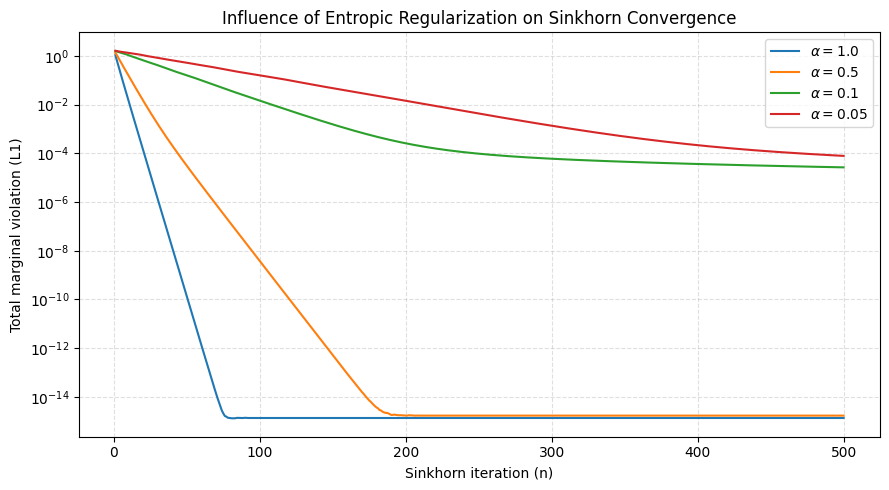
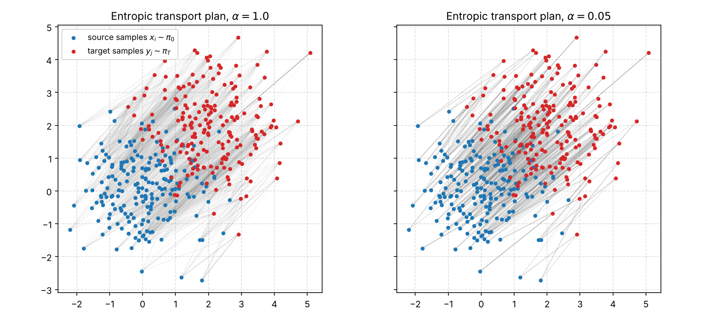

# Sinkhorn's Algorithm for the Static Schrödinger Bridge

Code accompanying the research internship report **"Introduction to the Schrödinger Bridge Problem"**
(Quang Khai (Deric) Truong, Toulouse School of Economics, Department of Mathematics and Statistics, 2026;
supervised by Adrien Blanchet).

The notebook implements a **log-domain (stabilized) Sinkhorn algorithm** for entropic optimal transport,
equivalently the static Schrödinger bridge, and reproduces every figure and table of Chapter 3 of the report.

## Experimental setup

| | |
|---|---|
| Source | 200 samples $x_i \sim \mathcal{N}(0, I_2)$, uniform weights |
| Target | 200 samples $y_j \sim \mathcal{N}((2,2), I_2)$, uniform weights |
| Cost | squared Euclidean, $C_{ij} = \lVert x_i - y_j \rVert_2^2$ |
| Regularization | $\alpha \in \{1.0, 0.5, 0.1, 0.05\}$ |
| Implementation | PyTorch, `float64`, log-domain updates, seed 42 |

## Main results

| $\alpha$ | Iterations to $10^{-6}$ | Cost $\langle C, P \rangle$ | Targets per source |
|---|---:|---:|---:|
| 1.0  | 31     | 8.503 | 110.6 |
| 0.5  | 69     | 8.107 | 74.0 |
| 0.1  | 9 201  | 7.771 | 24.5 |
| 0.05 | 10 279 | 7.732 | 14.8 |
| unregularized OT | – | 7.703 | 1 |

A large $\alpha$ converges in tens of iterations but gives a diffuse plan; a small $\alpha$ comes within 0.4% of the
optimal transport cost but needs thousands of iterations and log-domain arithmetic.




## Contents

| File | Description |
|---|---|
| `sinkhorn_experiments.ipynb` | Sinkhorn implementation and all experiments |
| `figures/` | Figures used in the report |
| `requirements.txt` | Python dependencies |

The notebook is organized as follows:
1. Base experiment ($\alpha = 0.05$, 500 iterations).
2. Effect of $\alpha$ on convergence (Figure 3.1 of the report).
3. Iterations needed to reach a marginal violation below $10^{-6}$ (Table 3.1).
4. Visualization of the entropic transport plans (Figure 3.2).
5. The 2 × 2 running example of the report, solved in a single Sinkhorn sweep.

## How to run

**Google Colab:** upload `sinkhorn_experiments.ipynb` and run all cells (no setup needed).

**Locally:**
```bash
git clone https://github.com/deric-truong/Schrodinger-Bridge-Sinkhorn.git
cd schrodinger-bridge-sinkhorn
pip install -r requirements.txt
jupyter notebook sinkhorn_experiments.ipynb
```

## References

- G. Peyré and M. Cuturi, *Computational Optimal Transport*, Foundations and Trends in Machine Learning, 2019.
- S. Tang, *Foundations of Schrödinger Bridges for Generative Modeling*, arXiv:2603.18992, 2026.
- R. Sinkhorn, *A relationship between arbitrary positive matrices and doubly stochastic matrices*, Ann. Math. Statist., 1964.

## License

MIT, see [LICENSE](LICENSE).
